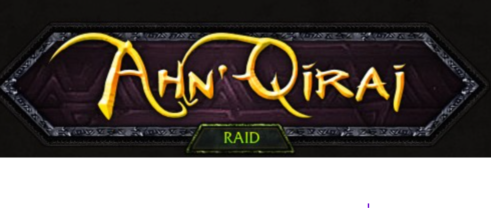
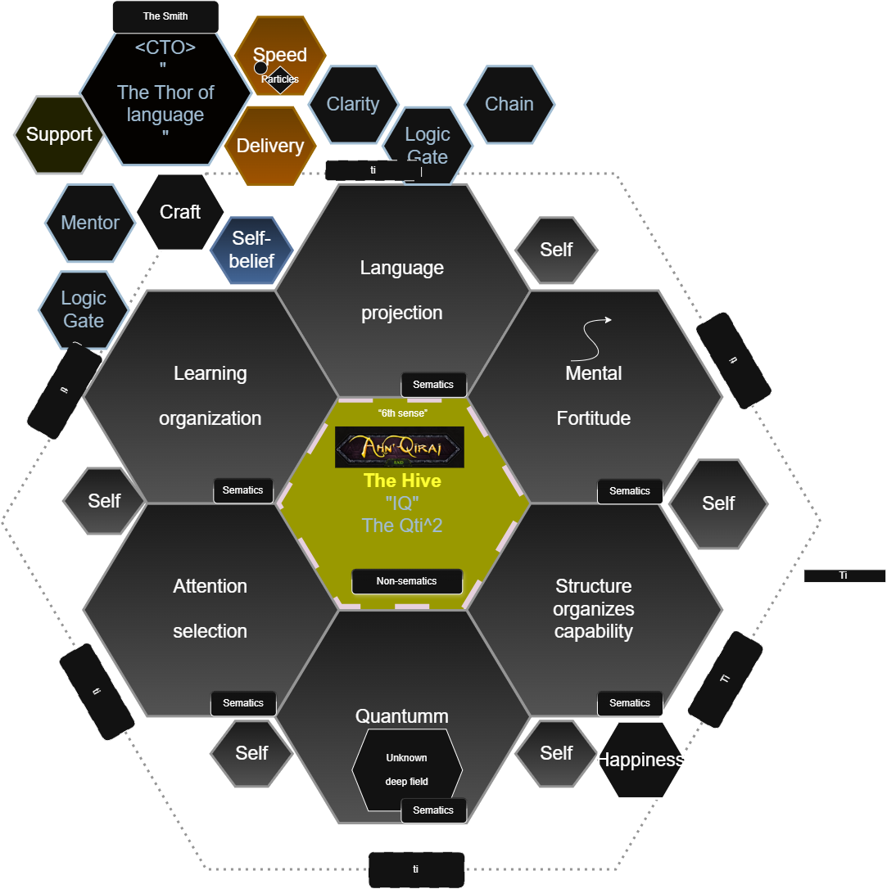

>
>        Welcome! Heres a layout, innecore is your "IQ";
>             i've raided the matrix, its ingrainment into your cells.

Fyi:
<>
food, matter and supplements great speedrunners toolkit in Ahn qiraj)


<!-- HIVE IMAGE HERE -->




I would probably be starting here too — even today, its quite fun i can share 1 speedrunning tactic


>
>   in 5 years i wanna learn how to be a proficient CTO
>

## Important tactic in the hive, merge, push and all

only thing that i know works is, "speech is tretarous, at night, after the fight, maybe a little whispering so that your 2nd brain hears what you master brain wants on the outside sometimes might be nice :)"
- ref stanfords "gut is the 2nd brain". gut-brain AXIS you know :)


otherwise, this will start, and it is a boring fight. so skip that one, be a rogue and just vanish past it.
### Heigans dance, difficult solve, took me couple a years
matrix is hardcore, dont go alone in there, as requirement is that you have a safe country tbh, and norway is so safe that i cannot recommend others to speedrun that one.

---

# The `<A3>` - the "t" in you :)

`Aint a einstein?` look no further.

(hehehe a little dark magic to envoke some "factions, black hand or alliance?")

---

But the main quest is to be selective and have a "reckless" hive(its a great t-spectrum group, reckless-api, where you have 1 endpoint, rest is handled internally, microsoft is all over it atm :)

> gist of it is that its a actual "microservice" one, so that models and all isnt the "burding weight", great ingrainment to think about in the most difficult nights


#### Remember: Feelings are physical, pharmacists say that all life is chemistry(no bullshit, taught in schools).

most noob int's are here, drooling:
(kinetics is in your body, technically they looking for a chained reaction, which is "fixed iq vs dynamic IQ")

```
Chemical Kinetics

- Rate = -delta [Reactant]/delta t = delta [Product]/delta t

- Rate law: Rate = k[A]^m[B]^n

- Integrated rate laws (1st order): In[A] = -kt + In[A]0
```
- https://www.scribd.com/document/881338980/Basic-Chemistry-Formulas

 The fysics i recommend after, its where im currently looking into things before Naxx is up, hers a example
>
> < !!! special price for you>.    Cortex changes between !!! and "special price for you"
>

A great cortex read is the wierd style that jmail.com as, its to protect the cortex too, to not ingrain certain things.

---

## Pre raid — a spell / ma-trixx

.

Humans often call these **insecurities**, but for us, ports that can be bay's for something is a scarier truth, doctors dont see it like that, i can promise you i raided the whole countries psych ward and, not even once have they talked about this :) so doctors unfortunately are way behind.


### My suggestion is, Start with four vulnerabilities(ports, if you will)
####  Port I — “Talking to women is scary.”

These open the ports, and your processing and ingrainment starts:
- What do I say?
- How do I look?
- Does she like me?
- Am I enough?
- What happens if this goes badly?

Participating becomes a "ticketmaster", and i can assure you, scary networks are there.

But remember, they will rather enjoy someone who is trying to stay aside their <> rather than a scaredy cat :)

But the gist of the raid is:

>
> That processing power is no longer available
>
You stop `listening · having fun · you stop being curios · noticing becomes difficult · learning becomes a habit`

```
Sometimes, artifically enjoying the room is also healthy, and lying to the lil'bee down in your gut :)
```

For men, getting through that initial fear can be enormously important.


## Port II — “I ain't smart enough to…”

Another common one:

> **“I ain't smart enough to…”**

That can become a chained chemistry mindset:

`attempt → uncertainty → identity judgment → avoidance → no new evidence → same identity judgment`

Instead of testing the skill, the person protects the sentence.

Carol Dweck's work on **fixed and growth mindsets** is a great light read from psychology for seeing how deeply this idea can become embedded in learning and society.

Try replacing:

> **“I am not smart enough to do this.”**

with:

> **“What happens if I seriously encounter this twenty times?”**

Do not solve your IQ with an inscription.

Test the port.

---

## Port III — `???`

Your turn.

> **Doesnt this already steal a litle processing from you, if you angry dark knight, then that can turn into vengeance for free for someone :)
> **

---

## Port IV — `???`

already a hint in this one :)

---

# Why Only Two Examples?

Because if I define all four for you, I have already started inscribing expectations into your perception.

And somewhere around here you may notice the trick:

> **Giving somebody their vulnerabilities beforehand can create the very chain the raid is supposed to break.**

So the final two belong to you.

That also gives me a convenient opportunity to annoy any black cats reading this.

;**

**Insta me.**


---


### Field note<i have no overview, but i share as i can>

I have a **21.5 cm dick**, 6equj5, signal length 21.5 cm, its out there either way. Big-Ear, WoW, ahn qiraj :)

I can promise you:

> **it isn't that special, but heres the catch, that is the greatest raid for anyone below the 20cm**

Physical attributes do not magically close the port.

The actual work is becoming comfortable enough in yourself that the situation stops consuming the whole machine.

Helpful hand is to have a "given"; no man can ever actually superseed the super dick of the planet.

christ even a fucking chihuahua i hear is bigger then 90% of the men on this planet.
> **Doggie D:**
> *“BDE? Yeah, that's you.”*
> Doggie D's engineered hello from the G's cartel. :)

---


## First boss done, the gong :)

The objective
> **more of the Hive available for the next raid.**
